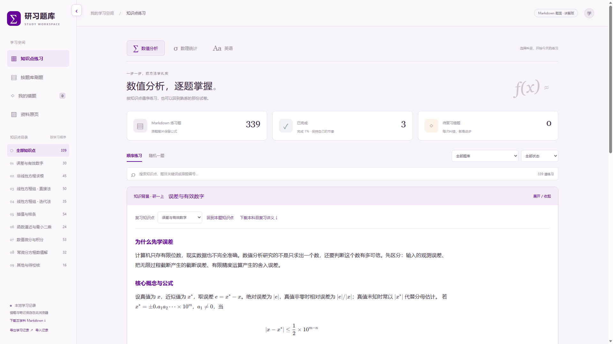

# 研习题库 · 数值分析、数理统计与英语

面向研一同学的本地复习网页。下载到自己的电脑后，即可按知识点或题库练习、记录解题过程，再展开 Markdown 参考答案。

## 刷题界面预览

下图为数值分析的实际界面，展示科目切换、知识点目录、学习进度及知识背景讲解。向下滚动即可进入题目和作答区，写完后点击查看参考答案；数理统计与英语使用相同的练习流程。



## 功能

- 数值分析 339 道题、数理统计 131 道题，另有英语 148 道练习，共 618 道练习；不同试卷中的重复题保留。
- 数学 21 个知识点及英语 3 类题型的背景讲解、配套例题和分步解析。
- Markdown 题面和数学公式，参考答案默认隐藏，点击查看。
- 按题库、知识点、完成状态筛选，以及关键词搜索、随机练习。
- 标记完成或错题后自动进入下一题；取消标记不会主动跳题。
- 作答笔记自动保存在自己的浏览器；支持导出、导入学习记录。
- 清华紫配色、可收起的左侧栏，刷新后保留侧栏状态。

英语覆盖新探索 U1—U4 的 8 份 A/B 篇资料：62 道词汇填空、35 道英译汉、51 道由原讲解改编的句式分析练习。参考答案与讲解来自原 PDF，另附 4 份完整单元讲稿的 Markdown 文本。原 PDF 词库个别笔误已对照讲稿注明校正。

## 在自己的电脑上使用

1. 在 GitHub 页面点击 **Code → Download ZIP**，解压整个项目；也可以使用 Git 克隆。
2. 安装 Python 3（已有 Python 或 Anaconda 可以跳过）。
3. 在项目根目录打开终端，运行：

```sh
python start.py
```

Windows 若找不到 `python`，可尝试 `py start.py`；macOS / Linux 可使用 `python3 start.py`。

浏览器会打开 [本地练习页面](http://127.0.0.1:8931/)。启动后的终端请保持打开；结束时按 Ctrl+C。启动器只监听本机。所有前端依赖已附带，无需 npm install，下载完成后可离线使用。

若提示端口被占用，先检查是否已经启动过本项目，不要重复开启。请保持使用同一个浏览器和地址。

## 英语题库怎么用

在网页顶部选择 **英语**，再选择 U1A 至 U4B 题库，或按“词汇运用与词形变化”“英译汉”“长难句与篇章表达”练习。在作答区写下答案后，点击“查看参考答案”核对。句式分析练习由讲解改编，不是原卷中的独立试题。

知识背景区域可下载 U1—U4 完整讲稿；答案区域可下载英语题库详解。“查看原页（含答案）”会显示带参考答案的资料原页。

## 更新到新版

已有用户先导出学习记录备份。使用 Git 下载的同学可在项目目录运行 `git pull`；使用 ZIP 下载的同学重新下载并解压最新版，关闭旧服务后，在新版目录运行 `python start.py`。继续使用同一浏览器和 `http://127.0.0.1:8931/`，原有学习记录通常可以直接保留，也可从备份导入。

## 作答与备份

在“我的作答 / 思路记录”中输入文字即可自动保存。刷新、关闭网页后，在同一浏览器中重新打开同一地址，仍可继续作答。答案默认折叠，写完后点击“查看参考答案”。

学习记录仅存放在本机浏览器的 localStorage 中，不上传 GitHub，也不会与同学共享。无痕模式、清理浏览器数据、换浏览器或更换端口可能导致原记录不可见。请定期使用侧栏的 **导出学习记录** 保存 JSON 备份；换电脑后使用 **导入记录** 恢复。导入时，相同题号的记录会被备份中的记录覆盖。侧栏收起时，点击左上角按钮展开即可找到备份入口。

## 项目结构

```text
start.py                 本地启动器（仅使用 Python 标准库）
practice/
  index.html             网页入口
  app.js / style.css     交互与样式
  data.js / catalog.json  题库数据
  answers.js / answers.json  Markdown 解答
  knowledge.js           知识背景与例题
  markdown/              可阅读、下载的题库和复习讲义
  assets/                原资料页面及题图
  vendor/                本地 Markdown、KaTeX 依赖
```

## 维护与纠错

发现题面或答案问题，请通过 Issue 提供科目、题库、题号、问题描述和建议修改。答案属于复习参考，部分原题条件缺失或含歧义，相应解答已注明假设，请结合课程讲义与老师讲解核对。

页面直接加载 data.js、answers.js 和 knowledge.js；只改 JSON 文件不会自动更新页面。修改题库或答案时应同步对应 JavaScript 数据，并更新 index.html 中资源的版本参数，避免缓存旧内容。修改题目 ID 会影响已有作答记录的对应关系。

题目及原始资料的权利归各自权利人所有，本项目不对这些资料授予额外许可。第三方依赖保留其原有许可证；如有资料授权问题，请联系维护者处理。

## 鸣谢

感谢 **2601 班张立同学**和**屈亚媛老师**提供的开源资料，为本项目的题库整理与复习内容建设提供了支持。
